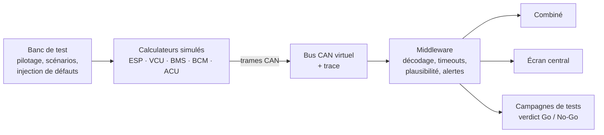
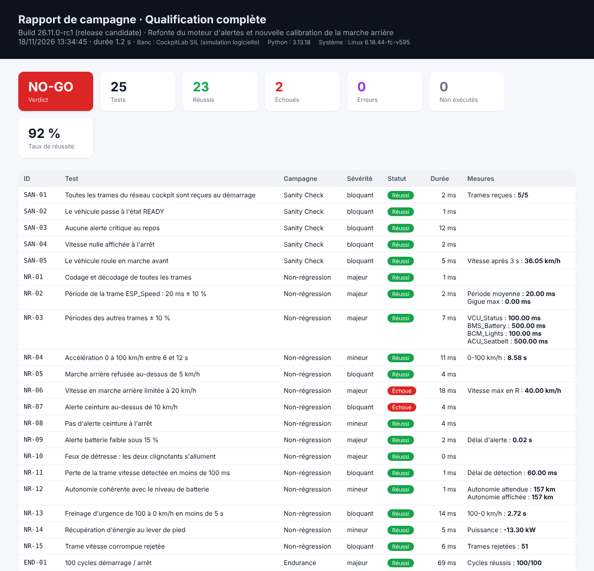
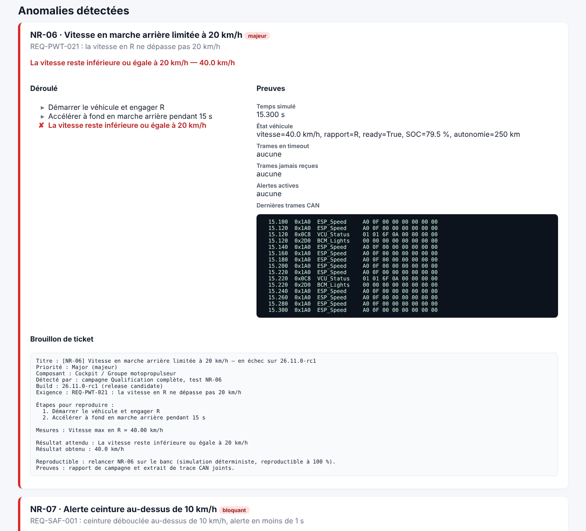
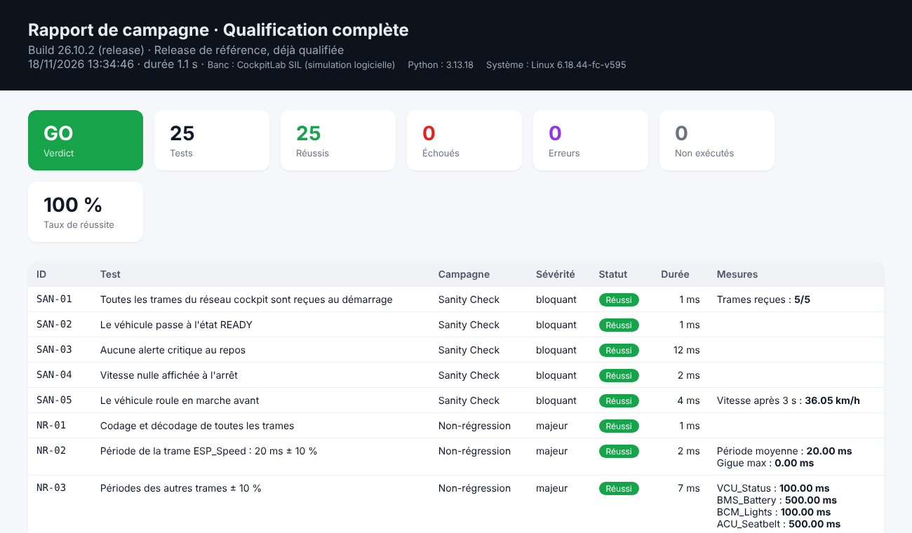
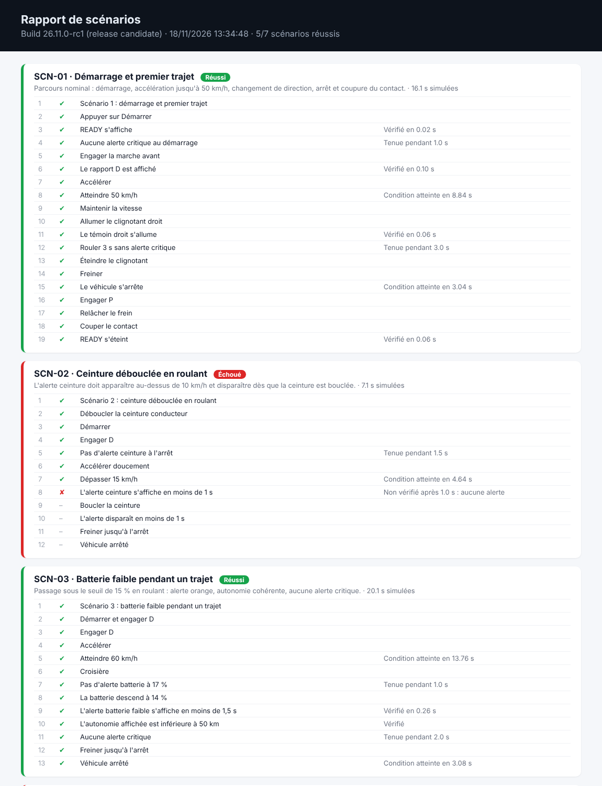

# CockpitLab


**Banc de validation d'un cockpit automobile simulé.**
Il qualifie des builds logicielles comme une équipe d'intégration : campagnes de
tests de sanity et de non-régression, analyse des anomalies avec preuves, et
verdict Go / No-Go pour chaque livraison.

---

## En une minute

- **Un cockpit simulé sur PC** : combiné d'instrumentation et écran central en
  PySide6, alimentés par un bus CAN virtuel et cinq calculateurs simulés
  (ESP, VCU, BMS, BCM, ACU).
- **Une qualification de builds** : 25 tests automatisés répartis en campagnes
  Sanity, non-régression, endurance et performance, avec un verdict Go / No-Go.
- **Des scénarios joués en direct** : le cockpit roule seul selon des scénarios
  écrits en JSON, pendant qu'on injecte des défauts (perte ou corruption de trames).
- **Des preuves exploitables** : rapports HTML et JUnit, trace CAN, brouillons de
  tickets d'anomalie prêts pour Jira.
- **Une intégration continue** : chaque push relance les tests et la
  qualification dans GitHub Actions.

## Architecture



Comme dans un vrai cockpit, les écrans ne lisent jamais le bus directement : ils
passent par un middleware (l'équivalent du Vehicle HAL d'Android Automotive),
qui détecte les trames perdues ou incohérentes.

## Qualification de cinq builds

Chaque build peut contenir des régressions cachées. Les campagnes doivent les
trouver.

| Build | Verdict | Détecté par |
|---|---|---|
| 26.10.2 (release de référence) | **GO** | 25 / 25 tests réussis |
| 26.11.0-rc1 | **NO-GO** | NR-07 alerte ceinture absente · NR-06 marche arrière à 40 km/h au lieu de 20 |
| 26.11.0-rc2 | **GO AVEC RÉSERVES** | NR-12 autonomie surestimée de 15 km (mineur) |
| 26.12.0-nightly.142 | **BUILD REJETÉE** | Sanity en échec : calculateur VCU muet, campagne arrêtée |
| 26.12.0-nightly.143 | **NO-GO** | NR-02 trame vitesse émise toutes les 26 ms au lieu de 20 |

| Verdict | Règle |
|---|---|
| BUILD REJETÉE | au moins un test de Sanity en échec |
| NO-GO | au moins un échec bloquant ou majeur |
| GO AVEC RÉSERVES | uniquement des échecs mineurs |
| GO | aucun échec |

**Le banc est lui-même testé** : une suite pytest vérifie que chaque régression
connue est détectée par le bon test, et seulement par lui.

### Rapport de campagne : la build rc1 est NO-GO



### Une anomalie : déroulé, preuves, trace CAN et brouillon de ticket



### La build de référence est GO



## Les campagnes

| Campagne | Tests | Exemples |
|---|---|---|
| Sanity Check | 5 | Toutes les trames reçues au démarrage, READY affiché, aucune alerte critique au repos |
| Non-régression | 15 | Périodes des trames CAN, alerte ceinture, refus de la marche arrière en roulant, perte et corruption de trames |
| Endurance | 2 | 100 cycles démarrage / arrêt, 20 minutes de conduite urbaine sans perte de trame |
| Performance | 3 | Temps de traitement d'une trame, charge du bus CAN, délai d'affichage de READY |

Chaque test est relié à une exigence (`REQ-SAF-001`, `REQ-NET-020`…) et porte une
sévérité (bloquant, majeur, mineur). Si la Sanity échoue, le reste de la campagne
n'est pas exécuté.

## Les scénarios joués en direct

| Scénario | Ce qu'il vérifie |
|---|---|
| SCN-01 Démarrage et premier trajet | Parcours nominal, sans alerte critique |
| SCN-02 Ceinture débouclée en roulant | Alerte au-dessus de 10 km/h, disparition quand on boucle |
| SCN-03 Batterie faible pendant un trajet | Alerte sous 15 %, autonomie cohérente |
| SCN-04 Manœuvre de stationnement | Marche arrière refusée en roulant, puis limitée à 20 km/h |
| SCN-05 Perte du calculateur ESP | Vitesse invalidée en moins de 100 ms, retour automatique |
| SCN-06 Trame vitesse corrompue | Donnée incohérente rejetée, jamais affichée |
| SCN-07 Freinage d'urgence | Arrêt depuis 110 km/h en moins de 5 s |



## Ce que le projet m'a appris

- **Les scénarios et les mesures se complètent.** La build nightly.143 passe tous
  les scénarios à l'écran, mais sa trame vitesse part toutes les 26 ms au lieu de
  20. Seule la mesure de période (NR-02) le voit.
- **Savoir où le banc ne voit rien.** Une corruption de la trame des feux passe
  inaperçue : elle ne transporte que des états binaires, sans grandeur
  contrôlable. Sur un vrai véhicule, ce type de trame est protégé par un CRC et un
  compteur (mécanisme E2E d'AUTOSAR). Cette limite est documentée et testée.
- **Distinguer « la trame n'arrive plus » de « la trame arrive mais son contenu
  est faux ».** Le cockpit affiche deux alertes différentes, comme le ferait un
  diagnostic de premier niveau.

## Lancer le projet

```powershell
python -m venv .venv
.venv\Scripts\activate
pip install -r requirements.txt
python main.py                                      # le cockpit et le banc de test
pytest -v                                           # les tests du projet
python -m cockpitlab.testing --build 26.11.0-rc1 --campaign complete
python -m cockpitlab.scenarios --build 26.11.0-rc1
```

Le détail technique (structure du code, format des scénarios, trames CAN,
plausibilité des données) est dans [DEVELOPPEMENT.md](DEVELOPPEMENT.md).

## Technologies

Python · PySide6 · python-can · pytest · GitHub Actions · HTML / JUnit XML

---

*Démonstration en direct sur demande : najiahmed340@gmail.com*
